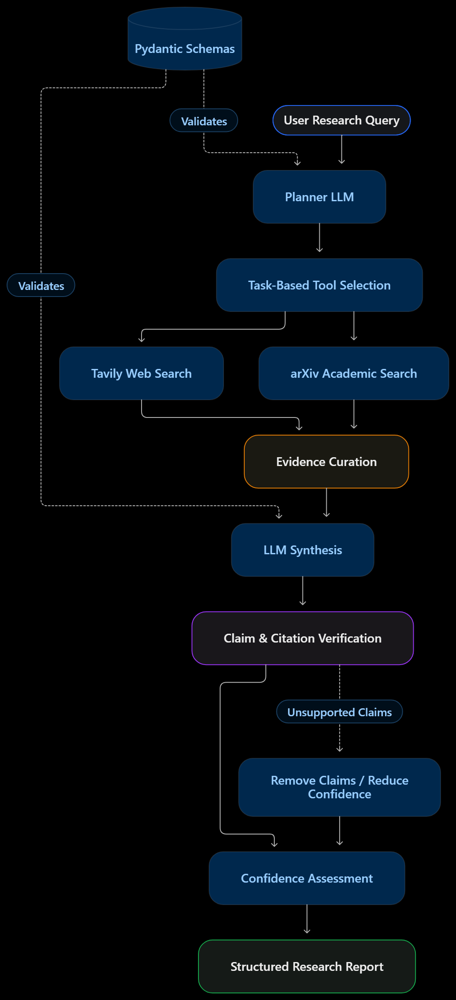

# AI Research Agent

A single-agent research assistant that plans research tasks, selects
tools, gathers and filters evidence, and generates structured,
source-backed reports with confidence levels and limitations.

## Overview

This project was built as a production-minded AI research agent. Rather
than treating research as a single prompt, it exposes a workflow for
planning, retrieval, evidence curation, synthesis, and claim checks.

### Key features

-   **Visible research workflow:** planning, tool selection, retrieval,
    evidence curation, synthesis, and verification.
-   **Task-based tool selection:** research tasks can use web search,
    arXiv search, or both.
-   **Multiple research tools:** Tavily for web search and arXiv for
    academic papers.
-   **Structured outputs:** Pydantic schemas validate planner and report
    outputs.
-   **Evidence curation:** URL deduplication, relevance filtering,
    source limits, and snippet trimming help control noisy or oversized
    evidence.
-   **Citation checks:** a heuristic verifier checks citation IDs,
    numerical claims, and lexical overlap with evidence snippets.
-   **Reliability handling:** fallback planning/report paths and
    handling for malformed model output and tool/API errors.
-   **Streamlit interface:** view the research workflow and final
    report.

> **Important:** The citation verifier is heuristic, not a guarantee of
> factual correctness. High-quality results still require source-level
> review.

## Architecture



The single-agent design keeps orchestration understandable while
allowing the system to select tools per task. It is appropriate for
research questions that benefit from multiple focused searches and a
final synthesis, without the coordination overhead of a multi-agent
system.

## Tech stack

-   Python
-   LangChain / LangGraph
-   Groq-hosted LLM (`openai/gpt-oss-20b`)
-   Tavily web search
-   arXiv search
-   Pydantic
-   Streamlit
-   pytest

## Getting started

### Prerequisites

-   Python installed
-   API key for Groq
-   API key for Tavily

### 1. Clone the repository

``` bash
git clone <YOUR_REPOSITORY_URL>
cd ResearchAgent
```

### 2. Create and activate a virtual environment

**Windows PowerShell**

``` powershell
py -m venv .venv
.\.venv\Scripts\Activate.ps1
```

If PowerShell blocks activation, use the Python executable inside
`.venv` directly or follow your machine's standard virtual-environment
policy.

### 3. Install dependencies

``` bash
python -m pip install --upgrade pip
pip install -r requirements.txt
```

### 4. Configure environment variables

Create a `.env` file in the project root:

``` dotenv
GROQ_API_KEY=your_groq_api_key
TAVILY_API_KEY=your_tavily_api_key
```

Do not commit `.env` or expose API keys in screenshots, logs, or source
control. Keep a `.env.example` with placeholder values if you want to
document the required variables.

### 5. Run the app

``` bash
streamlit run app.py
```

Open the local URL printed by Streamlit, enter a research question, and
review the plan, research activity, curated evidence, and final report.

### Run tests

``` bash
pytest
```

Use the test suite to check offline logic and failure-handling behavior.
Live tool and LLM tests may depend on network access and valid API keys.

## Project structure

The main modules are:

  -----------------------------------------------------------------------
  File                                Responsibility
  ----------------------------------- -----------------------------------
  `app.py`                            Streamlit user interface

  `runner.py`                         Runs the workflow and forwards
                                      progress/log messages

  `agent.py`                          Agent orchestration, planning,
                                      research, synthesis, and report
                                      generation

  `schemas.py`                        Pydantic models for structured
                                      plans and reports

  `reliability.py`                    Evidence curation, citation checks,
                                      confidence rules, and reliability
                                      helpers

  `requirements.txt`                  Python dependencies

  `.env`                              Local API credentials; do not
                                      commit

  `tests/`                            Automated tests
  -----------------------------------------------------------------------

Adjust this table if the repository's actual filenames or test layout
differ.

## Example output

The final report is designed to include:

-   User question
-   Short answer
-   Key findings
-   Sources used
-   Confidence level
-   Limitations and assumptions
-   Suggested next steps

### Sample outputs

-   [Research Agent sample outputs --- Google
    Doc](https://docs.google.com/document/d/1vUey9wQwKsMhNHyveE0Tk61Ufe7UXPY6cRizUwVi1-I/edit?usp=sharing)

The linked document contains recorded research runs and reports. Make
sure its sharing permissions allow reviewers to view it.

## Evaluation

The current recorded evaluation includes five completed research runs.
Relevance and citation support were manually assessed; the automated
verifier's "kept" status is not treated as proof of factual correctness.

  --------------------------------------------------------------------------
  Metric                              Current result Interpretation
  --------------------- ---------------------------- -----------------------
  Retrieval relevance     **87.10% (27/31 sources)** 27 of 31 retained
                                                     sources were judged
                                                     relevant across the
                                                     four substantive
                                                     research queries; the
                                                     intentionally
                                                     unanswerable query was
                                                     excluded.

  Citation support rate    **86.36% (19/22 claims)** 19 of 22 manually
                                                     checked claims were
                                                     judged supported by
                                                     their cited evidence.

  Abstention               **4/4 passed (100% on the The original
                                     initial test)** deliberately
                                                     unanswerable query was
                                                     correctly answered with
                                                     an
                                                     insufficient-evidence
                                                     response. Three
                                                     additional abstention
                                                     cases should be run
                                                     before reporting a 4/4
                                                     result.

  Average latency                   **43.8 seconds** Mean across the five
                                                     recorded runs,
                                                     including a slow
                                                     outlier.

  Median latency                      **19 seconds** Median across the five
                                                     recorded runs.

  Report generation              **10/10 runs (100%)** All 10 runs produced
                                                     a report.
  --------------------------------------------------------------------------

### Evaluation notes

-   Query relevance is a manual precision-style assessment of retained
    sources, not retrieval recall.
-   Citation support rate reflects a manual audit of claims against
    cited evidence.
-   Abstention quality should be measured on queries for which the
    requested information is genuinely unavailable, with expected
    behavior defined before running the test.
-   Report-generation success does not mean every component succeeded.
    Record component errors, retries, and total call counts separately.
-   The current five-run results should not be described as ten
    completed queries unless the additional queries have actually been
    run.

## Design decisions and trade-offs

-   **Single agent instead of multiple agents:** reduces complexity and
    makes the workflow easier to inspect.
-   **Web plus academic search:** supports both current web information
    and research-paper discovery.
-   **Structured outputs:** make the workflow more predictable and
    easier to validate.
-   **Evidence limits:** reduce prompt size and duplicate/noisy context,
    but may omit useful evidence.
-   **Heuristic claim verification:** inexpensive and fast, but can miss
    unsupported claims or incorrectly reject valid ones.
-   **Confidence caps and abstention:** help avoid presenting weak
    evidence as certainty, but depend on the quality of retrieval and
    verification signals.

## Known limitations

-   Search snippets may not contain enough context to verify every
    claim; opening and checking the original source is sometimes
    necessary.
-   Relevance scores and trust labels are signals, not guarantees of
    source quality.
-   Lexical-overlap citation checks are not semantic proof that a source
    entails a claim.
-   Search providers and arXiv may time out, rate-limit requests, or
    return errors.
-   Latency can vary significantly with external APIs.
-   Token usage and monetary cost are not yet fully instrumented.
-   The evaluation set is small; results should be treated as
    preliminary rather than general performance guarantees.

## Future improvements

-   Expand evaluation with a larger set of answerable,
    conflicting-evidence, and unanswerable questions.
-   Improve citation validation by checking source passages more deeply
    and evaluating claim entailment.
-   Add caching, timeouts, bounded retries, and clearer per-tool error
    reporting.
-   Add prompt-injection defenses for retrieved web content.
-   Compare the agent against a simple non-agentic
    retrieval-and-synthesis baseline.

## Security

-   Store credentials in environment variables or a local `.env` file.
-   Never commit secrets, private reports, or sensitive logs.
-   Treat retrieved web pages and papers as untrusted input, not as
    instructions to the agent.
